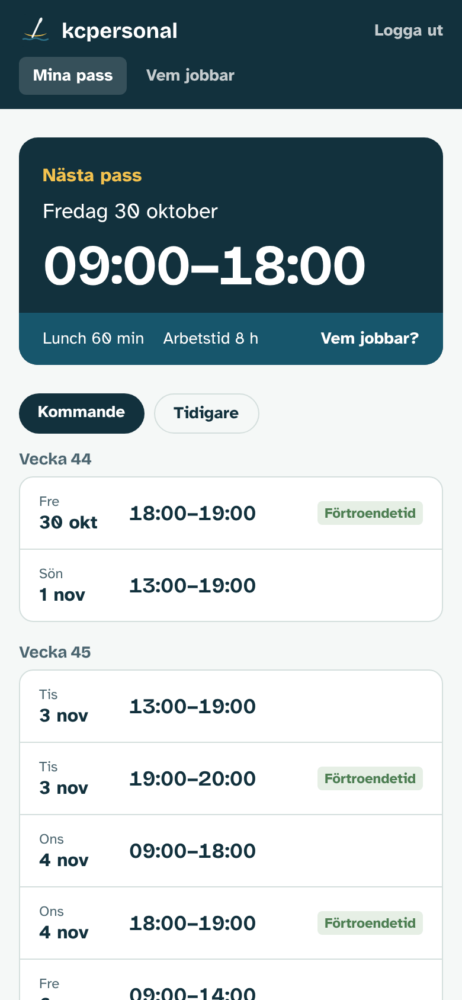
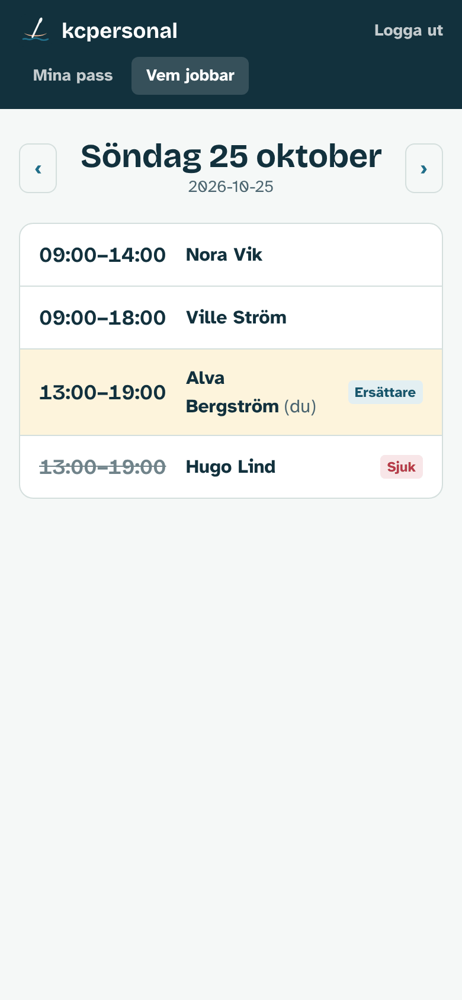
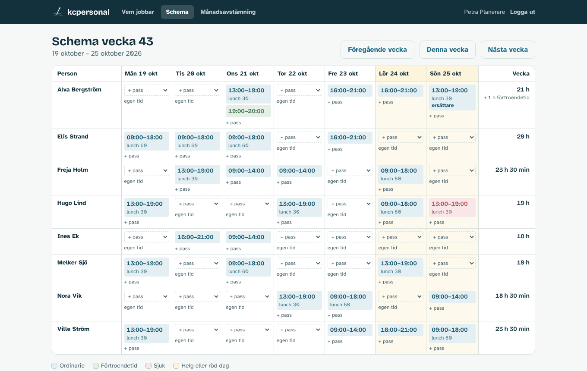
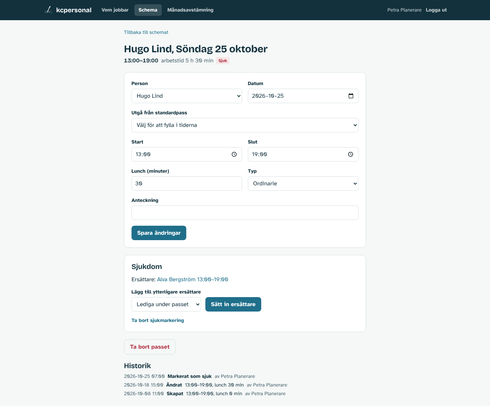
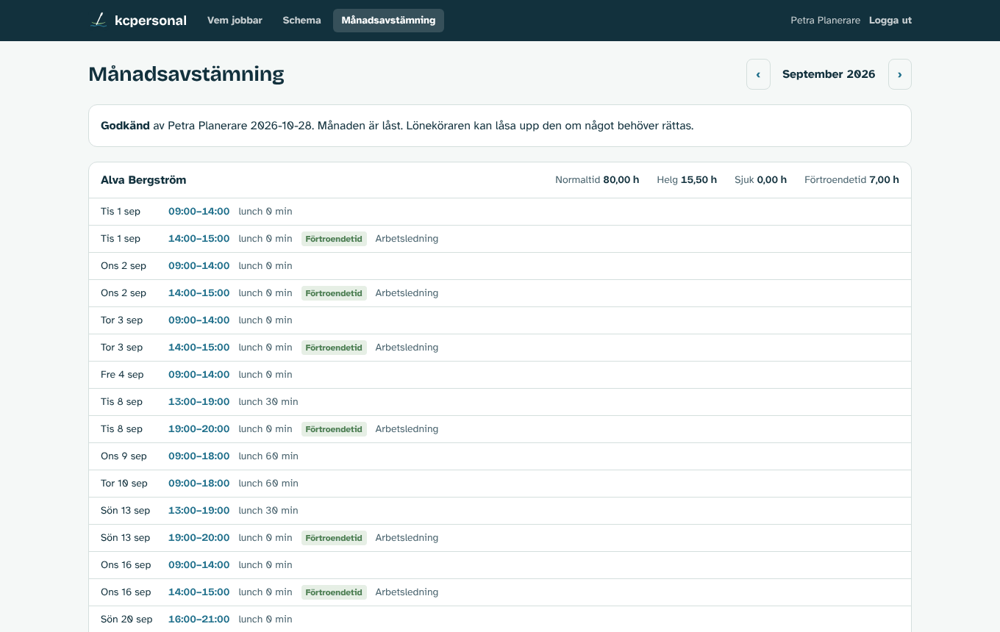
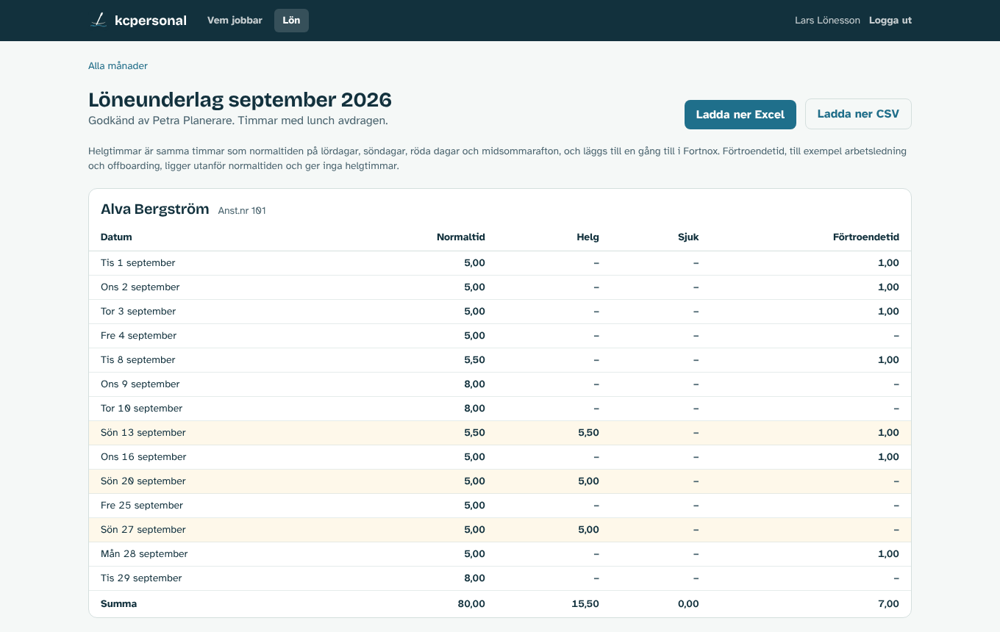
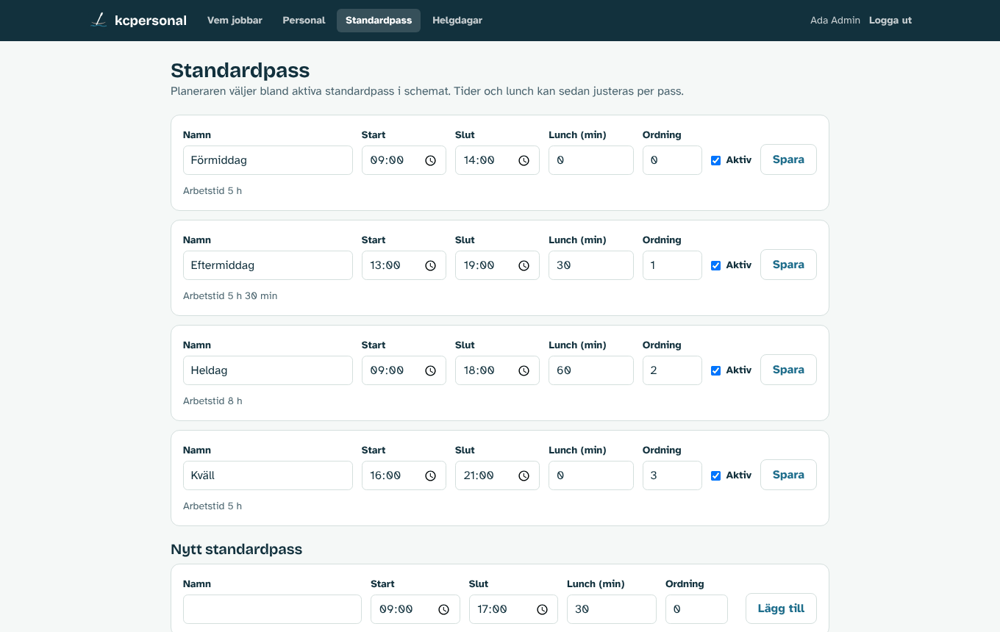

# kcpersonal

Internt verktyg för kanotcentralen (kc) för att planera sommarjobbarnas arbetspass, visa dem i mobilen och ta fram underlag till lönekörningen i Fortnox.

## Vad tjänsten gör

- **Sommarjobbare** ser sina pass i mobilen, och vem som jobbar samma dag.
- **Planerare** lägger schemat med standardpass eller justerade tider, hanterar sjukdom med ersättare, rättar avvikelser i efterhand och godkänner månaden.
- **Lönekörare** ser godkända månader med arbetad tid per person och dag, med lunch avdragen och helgtimmar och förtroendetid uppdelade, och exporterar underlag som förs in manuellt i Fortnox.
- **Admin** hanterar personal, standardpass och helgdagar.

## Skärmbilder

Bilderna visar påhittad demodata.

### Sommarjobbare (mobil)

<table>
  <tr>
    <td width="50%"></td>
    <td width="50%"></td>
  </tr>
  <tr>
    <td>Nästa pass överst och kommande pass per vecka.</td>
    <td>Vem som jobbar en dag, här med en sjukanmälan och en ersättare.</td>
  </tr>
</table>

### Planerare



Veckoschemat. Välj ett standardpass direkt i en tom ruta eller lägg en egen tid. Helger och röda dagar är gulmarkerade, sjuka pass röda och förtroendetid grön.



Ett pass som markerats som sjukt, med ersättare och ändringshistorik.



Månadsavstämningen med summor per person. Här rättas avvikelser och månaden godkänns.

### Lön



Löneunderlaget för en godkänd månad, med export till Excel och CSV.

### Admin



Standardpassen som planeraren väljer bland.

## Vad tjänsten inte gör

- Den samlar **inte** in känsliga personuppgifter (personnummer, bankuppgifter, adress, anhörig, skatt). Det görs fortsatt via Google Forms och matas in manuellt i Fortnox.
- Ingen in- och utstämpling. Planerad tid gäller som arbetad tid.

## Kom igång lokalt

Kräver Node.js 22.9 eller senare och PostgreSQL 14 eller senare.

```sh
npm install
cp .env.example .env            # fyll i DATABASE_URL och BETTER_AUTH_SECRET,
                                # sätt BETTER_AUTH_URL=http://localhost:3000
npm run db:migrate
npm run db:seed                 # påhittad demodata, raderar befintliga pass
npm run dev
```

Öppna http://localhost:3000 och logga in med någon av demoadresserna nedan. Utan `SMTP_HOST` skrivs inloggningslänken till terminalen där `npm run dev` körs.

| E-post | Roll |
|---|---|
| `admin@example.com` | Admin |
| `planerare@example.com` | Planerare |
| `lon@example.com` | Lön |
| `alva@example.com` (och `elis@`, `freja@`, `hugo@` …) | Sommarjobbare |

Föregående månad är godkänd i demodatan så att lönevyn har innehåll.

### Kommandon

| Kommando | Gör |
|---|---|
| `npm run dev` | Utvecklingsserver |
| `npm start` | Produktionsserver (`server.mjs`) efter `npm run build`, på `127.0.0.1:3000` eller `SOCKET_PATH` |
| `npm test` | Enhetstester (beräkningsregler, datum, helgdagar, export) |
| `npm run lint` | Typkontroll |
| `npm run db:generate` | Skapar migrering efter ändring i `src/db/schema.ts` |
| `npm run db:migrate` | Kör migreringar |
| `npm run db:seed` | Laddar påhittad demodata |
| `npm run create-admin -- e-post "Namn"` | Skapar en admin, eller ger en befintlig person admin-rollen |

## Driftsättning

Tjänsten körs på https://kcpersonal.npk.nu som en sub-server under npk.nu i Virtualmin. Node.js körs som en systemd-tjänst under användaren `npk.nu`, lyssnar på en unix-socket bakom Apache och använder PostgreSQL på samma server. Ingen Docker används.

Hela installationen steg för steg finns i [docs/drift.md](docs/drift.md). Uppdatering görs med:

```sh
~/domains/kcpersonal.npk.nu/app/scripts/deploy.sh
```

## Dokumentation

| Dokument | Innehåll |
|---|---|
| [docs/krav.md](docs/krav.md) | Bakgrund, roller och krav |
| [docs/vyer.md](docs/vyer.md) | Vyer och flöden per roll |
| [docs/datamodell.md](docs/datamodell.md) | Tabeller och beräkningsregler |
| [docs/fortnox.md](docs/fortnox.md) | Löneunderlag, export, helg och förtroendetid |
| [docs/arkitektur.md](docs/arkitektur.md) | Teknikstack, inloggning, sidor och kodstruktur |
| [docs/drift.md](docs/drift.md) | Installation och uppdatering på servern (Virtualmin, systemd, Apache) |
| [docs/etapper.md](docs/etapper.md) | Utvecklingsplan i etapper |
| [docs/beslut.md](docs/beslut.md) | Beslutslogg och öppna frågor |

## Teknik i korthet

Next.js 16 (TypeScript), PostgreSQL med Drizzle ORM, Better Auth med inloggningslänk via e-post, Tailwind CSS. Körs som systemd-tjänst bakom Apache på egen server.
